

# VOXEL RPG

**Воксельная action-RPG с бесконечным процедурным миром**

Unity 6 · URP · C# · собственные HLSL-шейдеры · Windows / Linux

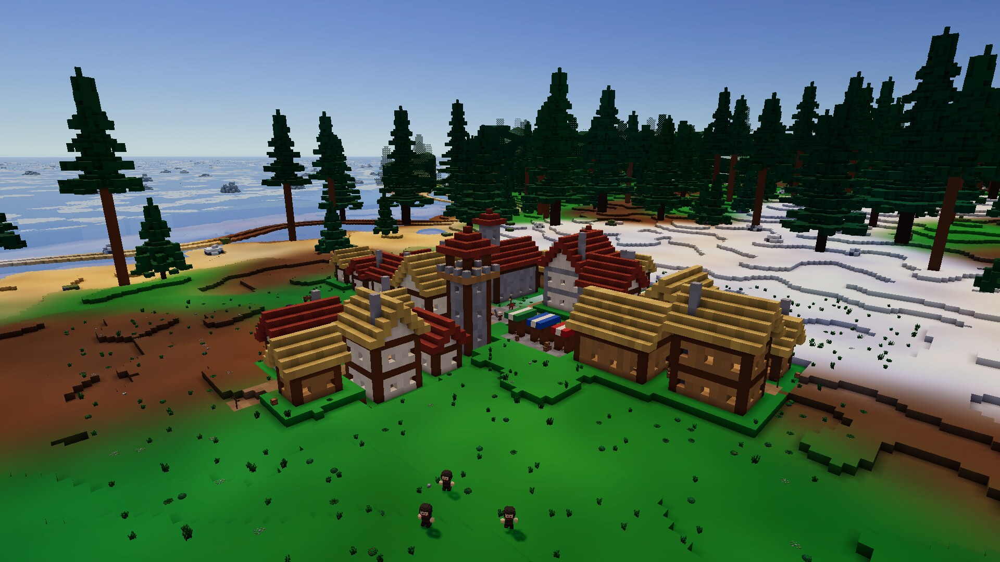

VOXEL RPG — action-RPG от третьего лица в духе Cube World. Персонаж путешествует по бесконечному миру из блоков, сражается со стаями существ, собирает добычу и развивает класс через большое дерево навыков. Мир генерируется на лету: материки и океаны, горные хребты, реки, озёра, 17 биомов, леса из огромных деревьев и деревни. Видно его на 4 км вперёд.

Это мой личный проект, написанный с нуля. Генерация мира, рендер дали, интерфейс, шрифт и звук — собственные системы, без сторонних плагинов.

---

## Демо

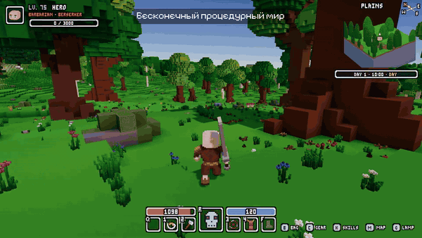

**[Скачать видео целиком — 53 секунды, 1080p (MP4, 24 МБ)](https://github.com/morinomiyamoto/VoxelRPG/raw/main/media/demo.mp4)**

---

## Коротко

| | |
|---|---|
| **Жанр** | action-RPG, исследование открытого мира |
| **Вид** | от третьего лица, клавиатура с мышью и геймпад |
| **Движок** | Unity 6 (URP), C# |
| **Платформы** | Windows, Linux; в планах Steam Deck |
| **Стадия** | ранняя разработка: мир и основные RPG-системы готовы, контент наполняется |
| **Объём** | ~49 000 строк C# в 186 файлах, 6 своих шейдеров, ~210 воксельных моделей |
| **Языки** | английский и русский |

---

## Мир

**Бесконечный и процедурный.** Мир состоит из чанков 16 × 512 × 16 блоков. Чанки подгружаются вокруг игрока и выгружаются за его спиной. Генерация построена на собственных шумах, без сторонних библиотек: симплекс-шум, фрактальный, хребтовый, ячеистый (Вороного), 3D-шум и террасы. Из одного seed-числа получается один и тот же мир.

- **Рельеф.** Материки и океаны, широкие возвышенности, холмы. Горные хребты поднимаются до ~430 блоков, на вершинах скалы и снег. По долинам вьются реки с перекатами, озёра держат свой уровень воды даже высоко в горах.
- **17 биомов.** Обычные (равнины, лес, осенний лес, тайга, тундра, саванна, пустыня, джунгли, болото) выбираются по карте температуры и влажности. Океан, тёплый с кораллами и островами или холодный со льдинами и айсбергами, определяется глубиной, альпийские луга — высотой гор. Отдельная «карта необычности» раскладывает редкие места: сакуровую рощу, волшебный и грибной лес, мёртвый лес, кратерное поле и магмовые земли. Соседство подчиняется климату: тундра никогда не граничит с пустыней, болота лежат только в низинах.
- **Особый рельеф.** Кратеры, вулканы с озером лавы, оазисы с пальмами, острова, столбы базальта, трещины с магмой, столовые горы в саванне, нависающие скалы.
- **Леса.** 35 процедурных видов деревьев, во много раз выше персонажа: дубы и клёны с кроной из шаров разных оттенков, ярусные ели под снегом, пальмы на изогнутых стволах, болотные грибы на корнях-ходулях со светящимися нитями, баобабы, гиганты джунглей с лианами. Каждое дерево собирается случайно по шаблону своего вида, и кроны соседей не врастают друг в друга.
- **Мелочь.** Больше 100 воксельных моделей (трава, цветы, кусты, грибы, кораллы, кристаллы) разложены по биомам. Яблоки лежат под лиственными деревьями, шишки под елями, тростник растёт на мелководье.
- **Деревни.** Деревянные, песчаные и тундровые, по 20–26 зданий, из них 10 уникальных: гостиница, кузница, мельница, часовня, сторожевая башня, рынок… Есть площадь с колодцем, дороги с фонарями и утварь. Названия деревень генерируются из слогов.
- **День и ночь.** Сутки длятся 24 минуты. Ночью светятся лава, магма, кристаллы и грибы, а под водой и в лаве свой туман.

---

## Геймплей

**Классы.** При создании персонажа выбирается один из четырёх классов, у каждого своё оружие и стиль боя:

| Класс | Оружие | Специализации |
|---|---|---|
| Разбойник | парные кинжалы | Ниндзя · Воришка |
| Варвар | двуручный меч, дубина | Защитник · Берсерк |
| Маг | посох, магические снаряды | Маг разрушения · Целитель |
| Рейнджер | лук, стрелы с баллистикой | Следопыт · Снайпер |

**Дерево навыков.** Окно на весь экран разделено диагоналями на сектора, ветки растут из центра. Дерево можно приближать и двигать, как в Path of Exile. Каждая специализация — это 49 перков на 150 очков:
- пассивные перки с несколькими уровнями;
- активные способности: вихрь, рывки, ловушки, турели, барьеры, бумеранги, призыв спутника, парирование;
- одно умение передвижения на клавише F;
- три ульты в концах веток, на клавишу R ставится одна.

Всего в игре 8 специализаций, 168 способностей и 36 типов эффектов.

**Бой.** Удары идут сериями из разных взмахов. Анимация удара играет на отдельном слое, поэтому ноги в это время продолжают бежать. Посох и лук стреляют в центр экрана с доводкой на цель. Есть отбрасывание, белая вспышка при попадании, всплывающие числа урона и уклонения. Хотбар внизу экрана: Q · 1 · 2 · **R** · 3 · 4 · F (еда, четыре способности, ульта, передвижение).

**Существа.** 26 видов, от слизней и крыс до троллей, големов и дракона. У каждого своя анимация: шаг, прыжки, ползание, парение, удары, жало, клешни. Кабаны ходят стаями, зовут сородичей, преследуют и убегают при малом здоровье. Нейтральные (пчёлы, крабы, йети, големы…) нападают только в ответ. Скелеты, зомби, призраки и летучие мыши выходят ночью. У каждого биома свой список обитателей.

**Добыча и снаряжение.** Трофеи вылетают из врага и подбираются клавишей E, золото само летит в кошелёк. Сумка делится на три раздела (снаряжение, еда, материалы) по 50 ячеек. Окно экипировки показывает 8 слотов и характеристики персонажа, иконки предметов рисуются из 3D-моделей автоматически.

**Карта как в Cube World.** Карта — это объёмная модель мира, её можно вращать, наклонять до горизонта и приближать. Неисследованное закрыто морем с сеткой и открывается по мере того, как вокруг игрока прогружаются чанки. Деревни с названиями видны всегда. Мини-карта в углу показывает квадрат мира, повёрнутый вместе с камерой.

**Остальное.** Плавание и ныряние, лампа на поясе для ночи, смена дня и ночи. Сохранения устроены как в Terraria: персонажи и миры отдельно, любого героя можно привести в любой мир. Автосохранение, главное меню на фоне живого мира, меню настроек (громкость, экран, управление, язык).

---

## Визуальный стиль

- **Без текстур.** У каждого блока свой цвет: градиент по высоте, оттенок биома и лёгкий разброс яркости. Затенение в углах (ambient occlusion) запекается прямо в цвета вершин, на границах биомов цвета плавно перетекают. Сверху работают тонмаппинг ACES, своя палитра и мягкий bloom.
- **Интерфейс из вокселей.** Весь интерфейс собран из одного эталонного 3D-кубика, снятого в картинку: рамки окон, кнопок, ячеек и полосок, клавиши-подсказки. Шрифт тоже свой, из кубиков, с кириллицей. Название игры в меню сложено из сотен объёмных кубиков.
- **Персонажи и существа** — модели MagicaVoxel/vengi из именованных частей. Собственный импортёр превращает их в риг с точками вращения в суставах, анимация работает через Animator и код.

---

## Звук

Все звуки синтезированы собственным генератором на Python (numpy/scipy), без чужих сэмплов и звуковых библиотек:
- **эмбиент** для 8 типов мест (лес днём и ночью, болото, кратеры, лава, берег, подводный мир, волшебный лес). У каждого 5 вариаций, игра чередует их в случайном порядке с плавными затуханиями и паузами тишины. Громкость выровнена по LUFS;
- **шаги** звучат по поверхности под ногами: земля, песок и снег, камень, дерево, вода;
- **16 звуков боя** и мягкие звуки интерфейса.

---

## Технологии и оптимизация

Главная техническая задача проекта — показать огромный мир на 4 км вперёд и держать при этом высокий FPS. Цель — 100+ кадров в секунду на ноутбучной RTX 3060.

### Многопоточная генерация
Генерация чанков, сборка мешей и запекание коллайдеров (`Physics.BakeMesh`) выполняются в фоновых рабочих потоках. Главный поток только копирует готовые данные в `Mesh` и укладывается в бюджет 2 мс на кадр. Ближние чанки строятся первыми, а меш для чанка, который уже ушёл из вида, просто выбрасывается.

### Лёгкие меши
- Отсечение невидимых граней: строятся только грани на границе с воздухом или прозрачным блоком.
- Цвет и затенение хранятся в вершинах, так что весь мир рисуется одним материалом, без текстур и атласов.
- Индексы 16-битные, 32-битные включаются только для больших мешей.
- От шумовых пещер я отказался: их скрытые стены составляли бóльшую часть меша. Без них треугольников в чанке стало в 4,5 раза меньше (3034 → 666), а генерация чанка ускорилась с 4,2 до 2,9 мс.
- Коллайдеры строятся только в радиусе 2 чанков от игрока: 25 вместо 289.

### Дальний рельеф до 256 чанков (4 км)
Полные чанки рисуются только в радиусе 16 чанков. Всё, что дальше, показывает отдельная система — clipmap из 4 уровней с клетками 2, 4, 8 и 16 блоков:
- высоты и цвета каждой клетки берутся прямо из генератора, с точной высотой блоков, поэтому даль не расходится с ближним миром;
- данные лежат в тороидальных текстурах и при движении игрока дописываются по краю, понемногу за кадр;
- все уровни рисуются одним общим мешем 64 × 64 клетки, рельеф поднимает вершинный шейдер;
- вблизи даль ступенчатая, как блоки, а с расстоянием ступени плавно сглаживаются в склоны, так что границ между уровнями не видно;
- деревья сразу за полными чанками строятся в настоящей форме кубами 2 × 2 × 2, дальше их заменяет полог крон;
- дома деревень видны блок к блоку на всю дальность, их меш собирается в фоне;
- маска чанков прячет даль под уже построенными полными чанками, а «круглый» туман в шейдере закрывает край мира.

| Замер на одном маршруте, полёт | Старые кольца лодов (2 км) | Дальний рельеф (4 км) |
|---|---|---|
| Кадров в секунду | 59 | **96** |
| Память под меши | 535 МБ | **181 МБ** |
| Управляемая куча | 906 МБ | **386 МБ** |

### Борьба с мусором и рывками
- Пулы для объектов чанков и массивов блоков: выгруженный чанк не уничтожается, а используется повторно.
- Без замыканий и лишних аллокаций в горячих путях. Мусора за кадр стало 2 КБ вместо 23 КБ, когда игрок стоит, и 58 КБ вместо 286 КБ в полёте.
- Мини-карту рисует отдельная камера не чаще 60 раз в секунду. Тайлы большой карты строятся из генератора в фоне, с LOD по дереву квадрантов.
- Итог последнего прохода оптимизации: **+21–29 % FPS**, мир загружается почти вдвое быстрее (11 → 6 с).

### Архитектура
- **Data-driven.** Биомы, деревья, валуны, стили деревень, враги, оружие, предметы, классы и перки хранятся в ScriptableObject-ассетах и настраиваются без кода.
- **Локализация.** Все тексты лежат в таблицах `ключ = текст`, названия данных привязаны к их id. Добавить новый язык — значит добавить ещё одну таблицу.
- **Инструменты разработчика.** Командная строка и панель администратора: телепорт к биому или деревне, призыв любого существа, выдача предметов, управление временем, подсветка уровней дальнего рельефа.

**Стек:** Unity 6 (6000.6), Universal Render Pipeline, C#, Input System, HLSL, MagicaVoxel / vengi, Python (синтез звука), Obsidian (журнал разработки).

---

## Галерея

| | |
|---|---|
| 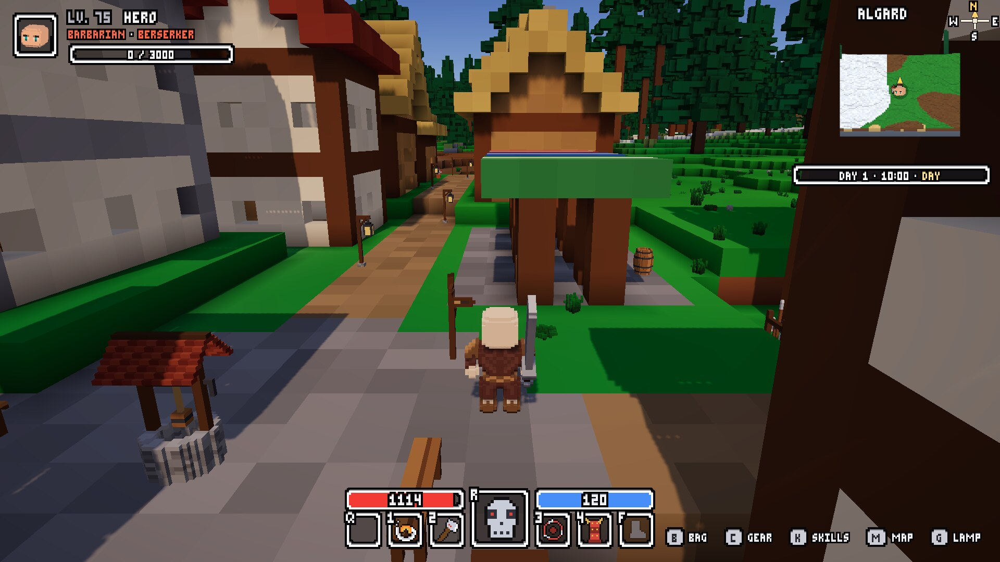 | 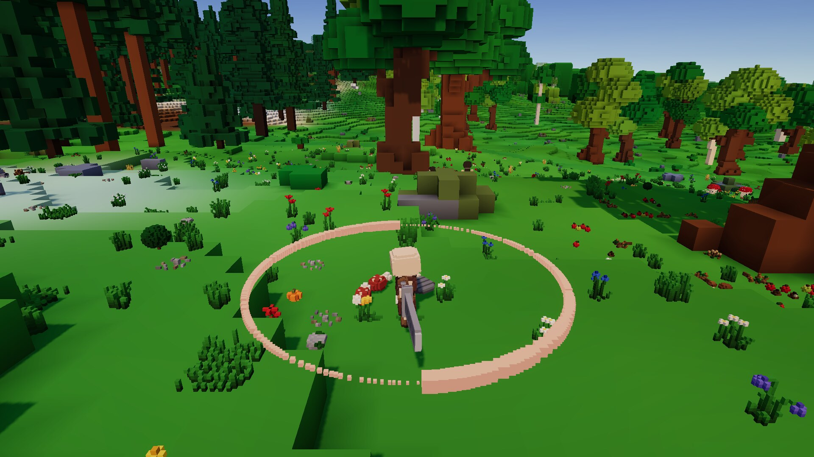 |
| Деревня Алгард: интерфейс, хотбар и мини-карта | Способность «Вихрь», с кабанов выпала добыча |
| 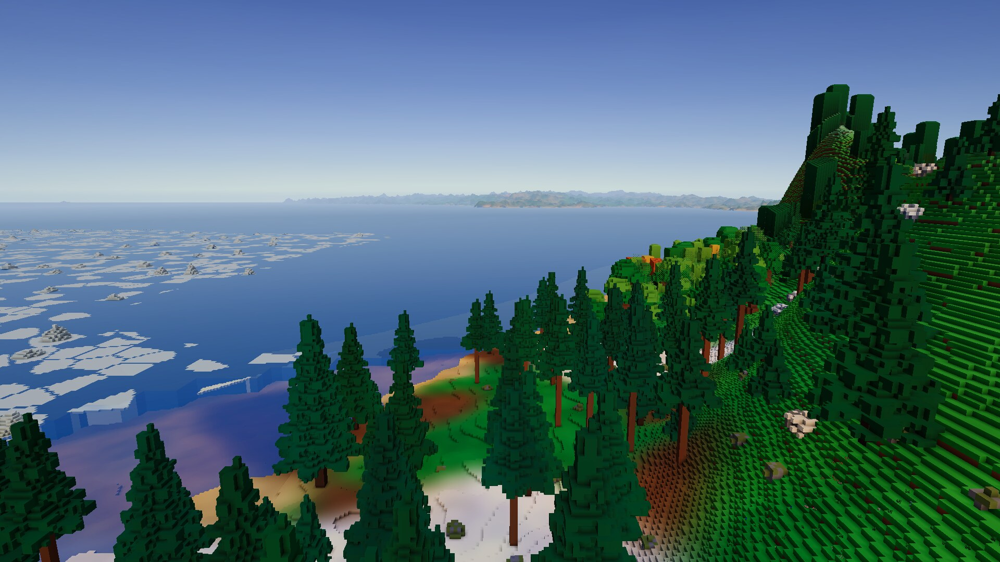 | 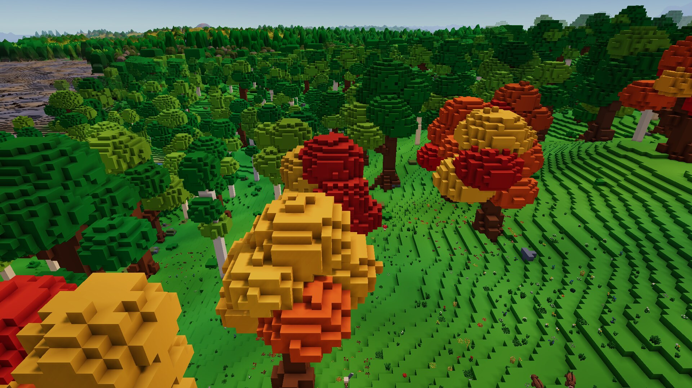 |
| Холодное море со льдинами, на горизонте берег в 4 км | Осенний лес |
| 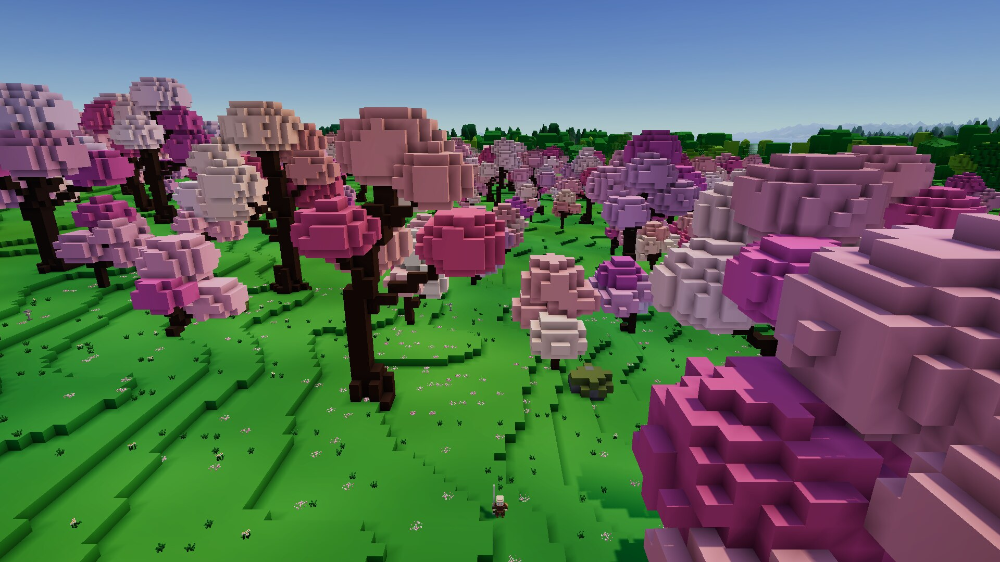 | 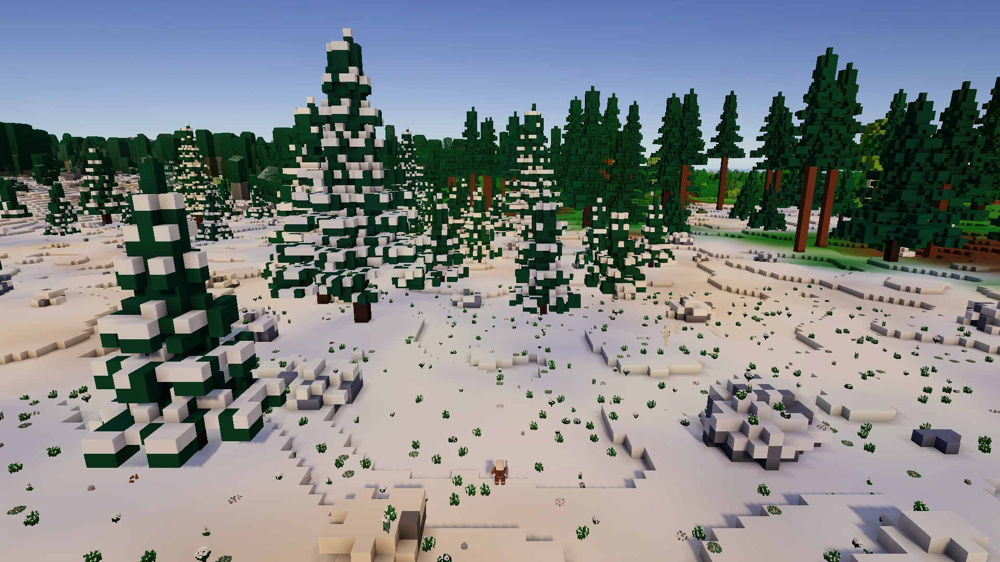 |
| Сакуровая роща — одно из редких мест | Тундра: ярусные ели под снегом |
| 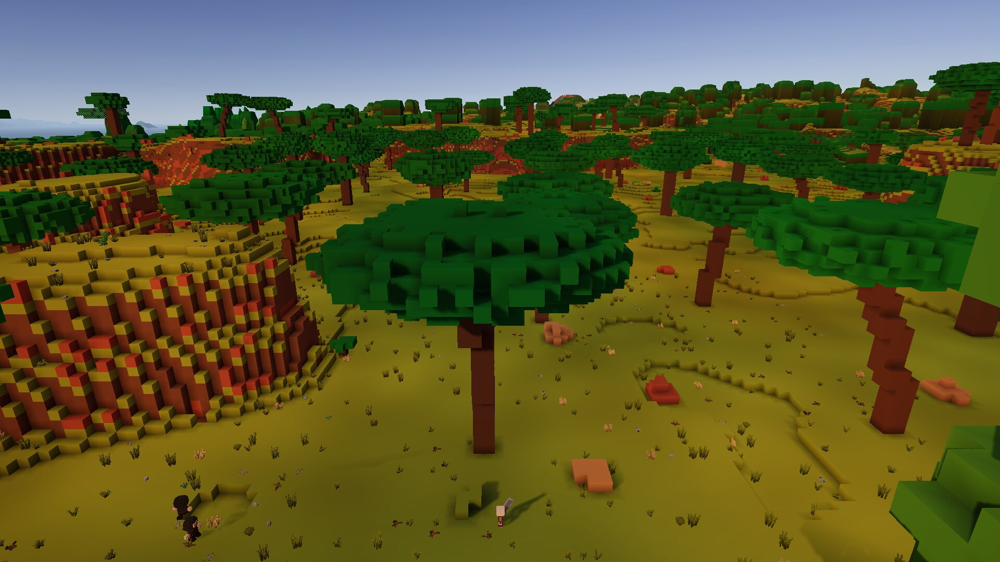 | 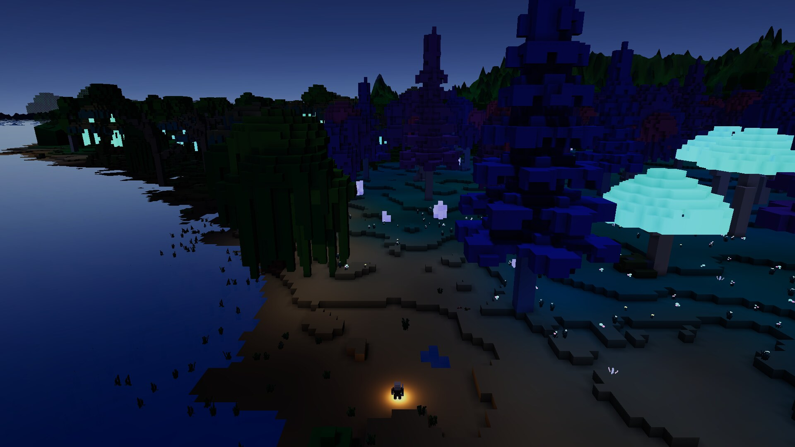 |
| Саванна со столовой горой | Волшебный лес ночью: светящиеся грибы и лампа героя |
| 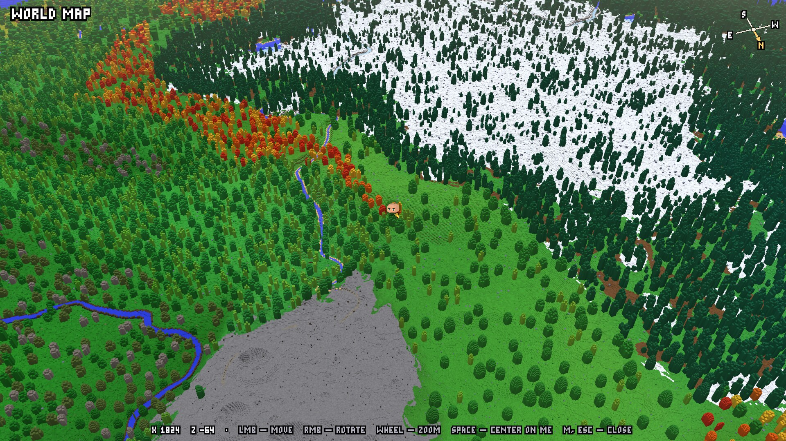 | 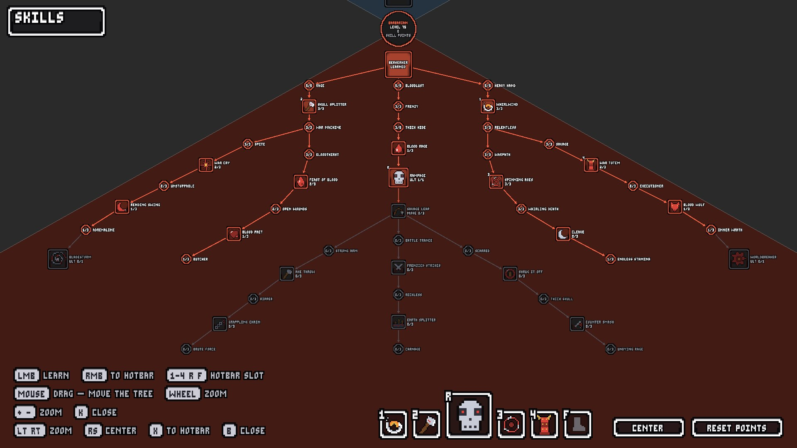 |
| Объёмная карта: реки, кратер, тайга и тундра | Дерево навыков берсерка |
| 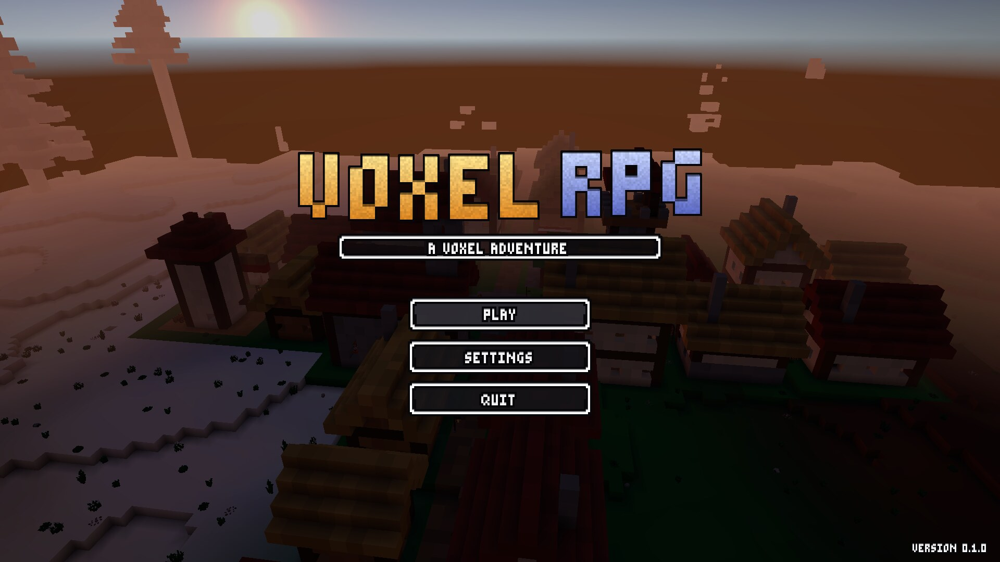 | 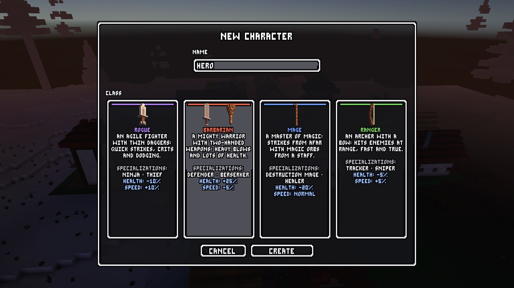 |
| Главное меню: название из объёмных кубиков | Создание персонажа: выбор класса |

---

## Что уже есть

- [x] Бесконечный мир: 17 биомов, реки, озёра, горы, особый рельеф
- [x] Деревья, мелочь из моделей, деревни трёх стилей
- [x] Дальность прорисовки 4 км при высоком FPS
- [x] Смена дня и ночи, светящиеся блоки, вода и лава
- [x] Герой от третьего лица: бег, прыжки, плавание, анимации
- [x] 4 класса, 8 специализаций, большое дерево навыков, способности и ульты
- [x] Бой ближний и дальний, 26 видов существ с поведением
- [x] Добыча, золото, сумка, экипировка
- [x] Объёмная карта и мини-карта с туманом войны
- [x] Сохранения, главное меню, меню паузы и настроек
- [x] Интерфейс из вокселей, свой шрифт
- [x] Синтезированные звуки: эмбиент, шаги, бой, интерфейс
- [x] Английский и русский языки

## Будущее проекта

Ближайшие шаги:
- **Атмосфера биомов**: свой цвет неба и тумана в каждом биоме, частицы (снежинки в тундре, лепестки в сакуровой роще, пепел над магмой, светлячки на болоте).
- **Новые существа и боссы**: в запасе уже 40 моделей существ для разных биомов (вулкан, побережье, тундра, пещеры, магические места) и 21 модель боссов. Им нужны поведение и анимации.
- **Ресурс для способностей** (мана или энергия) и балансировка всех веток навыков.
- **Новое оружие в добыче**: в запасе 85 моделей (мечи, топоры, молоты, луки, посохи). У предметов появится редкость с цветом рамки и названия.
- **Торговцы в деревнях**, чтобы золото было на что тратить, и новые стили деревень: на сваях в джунглях и на болоте, восточная в сакуровой роще.
- **Музыка** в том же подходе, что и звуки: своя, синтезированная.

Дальше:
- **Подземелья и пещеры**: немного, в особых местах и со входами, а не шумом по всему миру.
- **Парящие острова** — восемнадцатый биом: острова над землёй, до которых можно добраться прыжками, без полёта.
- **NPC и задания**, чтобы у исследования мира была цель.
- **Steam Deck**: отдельный пресет графики и масштаб интерфейса.

Идеи на перспективу:
- **Кооператив на 2–4 игроков**: мир детерминирован по seed, поэтому по сети нужно синхронизировать только изменения и существ, а не сам рельеф.
- **Разрушаемый рельеф** от взрывов и сильных способностей: изменение блоков с перестройкой соседних чанков уже работает в движке мира.
- **Быстрые перемещения и метки на карте**: карта уже знает все деревни и их названия.
- **Фоторежим** со свободной камерой и управлением временем суток.

---

Разработка ведётся с марта 2026 года. Журнал разработки — больше 70 заметок о каждом этапе — я веду отдельно.

